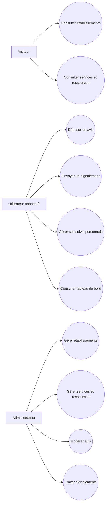
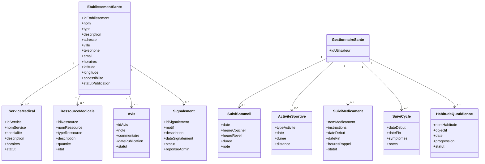

# BloodLink — Conception du module Services de santé

## 1. Périmètre fonctionnel

### EtablissementSante
Une entité fonctionnelle qui regroupe cinq groupes de fonctionnalités :
1. Gestion des établissements.
2. Gestion des services médicaux.
3. Gestion des ressources médicales.
4. Gestion des avis.
5. Gestion des signalements.

### GestionnaireSante
Un espace personnel qui regroupe six groupes de fonctionnalités :
1. Gestion du sommeil.
2. Gestion des activités sportives.
3. Gestion des médicaments et rappels saisis.
4. Suivi facultatif du cycle menstruel.
5. Gestion des habitudes quotidiennes.
6. Tableau de bord, historique et statistiques.

## 2. Acteurs
- Visiteur : consultation des établissements, services et ressources publiés.
- Utilisateur connecté : consultation, dépôt d'avis et signalements, gestion de ses propres suivis personnels.
- Administrateur autorisé : gestion des établissements, services et ressources ; modération des avis ; traitement des signalements.

## 3. Règles de gestion essentielles
- Seul un administrateur autorisé gère les établissements, services et ressources.
- Chaque service et ressource est rattaché à un établissement.
- Un utilisateur ne modifie et ne supprime que ses propres avis et données personnelles.
- Les avis sont soumis à modération avant publication.
- Les signalements possèdent un statut et peuvent recevoir une réponse administrative.
- Les données du GestionnaireSante sont privées.
- Les statistiques sont calculées à partir des enregistrements saisis.
- Le suivi du cycle est facultatif.
- Les rappels de médicaments reproduisent les instructions enregistrées et ne constituent pas une prescription.

## 4. Diagramme de cas d'utilisation — vue synthétique

## 5. Diagramme de classes — vue conceptuelle

## 6. Architecture MVC
- Model : accès aux données (dans ce prototype, collections en session PHP uniquement).
- Controller : reçoit les actions, contrôle les droits, valide les données et choisit la vue.
- View : affiche les pages HTML.
- `Service/` : réservé à l'authentification, aux sessions et aux rôles communs de l'équipe ; à raccorder lors de l'intégration.

## 7. À présenter pendant la validation
1. Montrer la consultation Front Office.
2. Se connecter au Back Office et montrer le CRUD établissement.
3. Montrer la gestion des services et ressources.
4. Déposer un avis puis expliquer la modération.
5. Envoyer un signalement et montrer son traitement administratif.
6. Ouvrir le GestionnaireSante et montrer les catégories de suivi.
7. Expliquer clairement que le stockage par session est temporaire et sera remplacé par la couche d'accès à la base commune.
