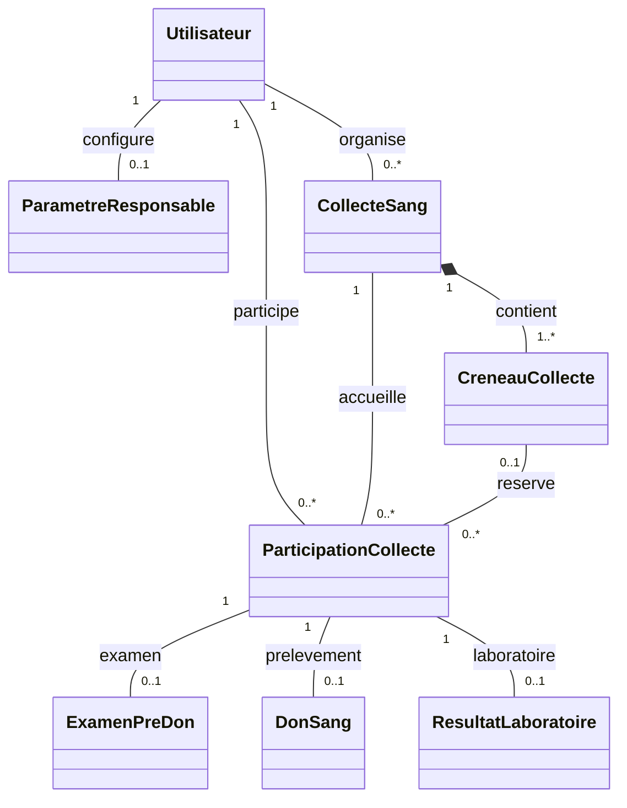

# BloodLink — Collectes et Dons de Sang


Application web **PHP / MySQL (MVC)** dédiée à la planification des collectes de sang, au suivi médical pré-don, à la qualification biologique des poches en laboratoire et à la diffusion d’alertes urgentes **SOS Sang**.

---

## Overview

| Espace | Actions principales |
| :--- | :--- |
| **Donneur** | Recherche et filtrage des collectes (dates et horaires 24h), réservation de créneau, carte QR, suivi du délai de 12 semaines et historique des dons. |
| **Responsable** | Gestion des collectes et galeries photos, accueil (en ligne, sur place, scan QR), examen médical pré-don, prélèvement par poches (`450 ml`) et validation laboratoire. |
| **Administrateur** | Tableaux de bord du sang sain par groupe sanguin, statistiques par collecte, gestion des comptes et des rôles, invitations responsables et modération SOS. |

---

## Features

- **Collectes & Créneaux 24h** — Filtrage par ville, dates (`Du / Au`) et plage horaire (`De / À`), galerie photos et réservation selon les places disponibles.
- **Parcours Médical & Laboratoire** — Examen pré-don (`APTE` / `AJOURNE`), prélèvement par poches (`1 poche = 450 ml` par défaut), dépistages sérologiques (`VIH`, `VHB`, `VHC`, `Syphilis`) et calcul automatique du délai de 12 semaines.
- **Alertes SOS Sang (2h)** — Publication rapide d’appels urgents avec calcul automatique des groupes compatibles et expiration au bout de 2 heures.
- **Sécurité & Sessions** — Authentification par rôle (`DONNEUR`, `RESPONSABLE`, `ADMIN`), invitations SHA-256 à usage unique, protection CSRF/XSS et expiration après inactivité.

---

## Tech Stack

### Frontend
- **HTML5 / CSS3** — `public/assets/css/bloodlink.css`, `public/assets/css/app.css`
- **JavaScript ES6** — `validation.js`, `forms.js`, `experience.js`, `qrcode.js`

### Backend
- **PHP 8.2+** — Architecture MVC, Singleton PDO, sessions sécurisées
- **MySQL / MariaDB** — Base relationnelle `bloodlink_piweb_2a6`

---

## Architecture

```text
Esprit-PIWEB-2A6-2026-BloodLink/
├── config/config.php          # Connexion PDO (Singleton)
├── Model/                     # 9 entités métier
├── Controller/                # 9 contrôleurs métier
├── Service/Securite.php       # Sessions, rôles, CSRF et XSS
├── View/
│   ├── front-office/          # Vues publiques et donneur (includes/)
│   └── back-office/           # Vues admin et responsable (partials/)
├── database/
│   └── database.sql           # Schéma MySQL
├── public/                    # Assets CSS/JS, images et uploads
└── index.php                  # Routeur principal
```

---

## Getting Started

1. **Cloner le dépôt** dans `C:\xampp\htdocs` :
   ```bash
   git clone https://github.com/Bacem-Trimech/Esprit-PIWEB-2A6-2026-BloodLink.git
   ```
2. **Démarrer Apache et MySQL** dans XAMPP.
3. **Importer `database/database.sql`** dans `http://localhost/phpmyadmin`.
4. **Ouvrir l’application** : `http://localhost/Esprit-PIWEB-2A6-2026-BloodLink/`

---

## Academic Context

Projet développé à **Esprit School of Engineering** dans le cadre du module **Projet Intégré Technologies Web (PIWEB)** — Classe **2A6** (2026–2027).

## Contributors

- **Bacem Trimech** — Module **BloodLink**

## Acknowledgments

- Équipe enseignante du module **PIWEB** à **Esprit School of Engineering**.

---

## Entités du Modèle

### 1. Les 9 Entités (`Model/`)

| Entité & Table | Rôle | Attributs |
| :--- | :--- | :--- |
| **`Utilisateur`**<br>`utilisateurs` | Comptes (`DONNEUR`, `RESPONSABLE`, `ADMIN`), profil, QR et invitations. | `id (PK)`, `nom`, `email`, `mot_de_passe_hash`, `role`, `telephone`, `ville`, `date_naissance`, `groupe_sanguin`, `avatar_couleur`, `qr_identifiant`, `invitation_hash`, `invitation_expire_le`, `actif`, `profil_complet` |
| **`CollecteSang`**<br>`collectes` | Campagne de collecte (lieu, horaires 24h, couverture et galerie 4 photos). | `id (PK)`, `titre`, `adresse`, `ville`, `debut`, `fin`, `statut`, `image_url`, `galerie_json`, `organisateur_id (FK)` |
| **`CreneauCollecte`**<br>`creneaux` | Tranche horaire réservable et capacité de places. | `id (PK)`, `collecte_id (FK)`, `debut`, `fin`, `capacite`, `statut`, `reserves` |
| **`ParticipationCollecte`**<br>`participations` | Inscription d’un donneur (`EN_LIGNE` ou `SUR_PLACE`) et arrivée. | `id (PK)`, `collecte_id (FK)`, `creneau_id (FK)`, `donneur_id (FK)`, `mode`, `statut`, `code_confirmation`, `arrivee_le` |
| **`ExamenPreDon`**<br>`examens_pre_don` | Constantes médicales avant don et décision (`APTE` / `AJOURNE`). | `participation_id (PK/FK)`, `tension_systolique`, `tension_diastolique`, `pouls`, `temperature_c`, `hemoglobine_g_dl`, `poids_kg`, `decision`, `saisi_par (FK)`, `saisi_le` |
| **`DonSang`**<br>`dons_sang` | Prélèvement confirmé (`1 poche = 450 ml` par défaut) et code poche. | `id (PK)`, `participation_id (FK)`, `effectue_le`, `confirme_par (FK)`, `volume_ml`, `numero_poche` |
| **`ResultatLaboratoire`**<br>`resultats_laboratoire` | Groupe confirmé, 4 dépistages (`VIH`, `VHB`, `VHC`, `Syphilis`) et prochain don. | `participation_id (PK/FK)`, `groupe_confirme`, `statut`, `vih`, `vhb`, `vhc`, `syphilis`, `statut_prochain_don`, `prochain_don_le`, `saisi_par (FK)` |
| **`AlerteSos`**<br>`alertes_sos` | Appel urgent au don de sang valable 2 heures. | `id (PK)`, `lieu`, `ville`, `groupe_receveur`, `telephone`, `message`, `cree_le`, `expire_le` |
| **`ParametreResponsable`**<br>`parametres_responsable` | Nom du centre et capacité par défaut des créneaux. | `responsable_id (PK/FK)`, `nom_organisation`, `capacite_defaut`, `contact_public`, `message_accueil` |

### 2. Modèle Fusionné (4 Entités + 1 `Utilisateur`)

| Entité | Fusion | Rôle | Attributs |
| :--- | :--- | :--- | :--- |
| **`Utilisateur`** | `Utilisateur` + `ParametreResponsable` | Compte utilisateur et paramètres du centre responsable. | `id (PK)`, `nom`, `email`, `mot_de_passe_hash`, `role`, `telephone`, `ville`, `date_naissance`, `groupe_sanguin`, `qr_identifiant`, `nom_organisation`, `capacite_defaut`, `actif` |
| **`CollecteSang`** | Irréductible (`1..N`) | Journée de collecte de sang, horaires 24h et photos. | `id (PK)`, `titre`, `adresse`, `ville`, `debut`, `fin`, `statut`, `image_url`, `galerie_json`, `organisateur_id (FK)` |
| **`CreneauCollecte`** | Irréductible (`1..N`) | Plage horaire réservable au sein d’une collecte. | `id (PK)`, `collecte_id (FK)`, `debut`, `fin`, `capacite`, `statut` |
| **`ParticipationCollecte`** | `Participation` + `Examen` + `Don` + `Labo` | Inscription, arrivée, examen pré-don, poche prélevée et résultat labo. | `id (PK)`, `collecte_id (FK)`, `creneau_id (FK)`, `donneur_id (FK)`, `mode`, `statut`, `code_confirmation`, `arrivee_le`, `tension_sys`, `tension_dia`, `pouls`, `temperature_c`, `hemoglobine`, `poids_kg`, `decision`, `volume_ml`, `numero_poche`, `effectue_le`, `groupe_confirme`, `vih`, `vhb`, `vhc`, `syphilis`, `statut_labo`, `prochain_don_le` |
| **`AlerteSos`** | Irréductible | Alerte urgente publique valable 2 heures. | `id (PK)`, `lieu`, `ville`, `groupe_receveur`, `telephone`, `message`, `cree_le`, `expire_le` |

### 3. Diagramme de Classes


