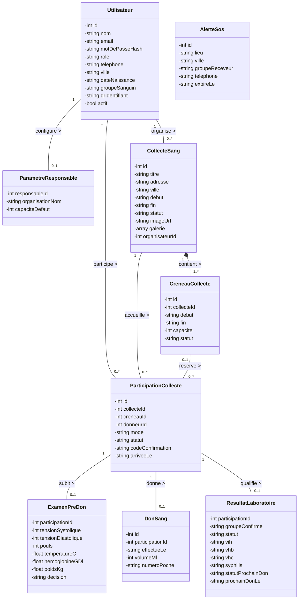

# BloodLink — Plateforme de Collectes et Dons de Sang

**BloodLink** est une application web PHP/MySQL dédiée à la gestion des collectes de sang, à la prise de rendez-vous des donneurs, au suivi médical pré-don, à la qualification biologique des poches en laboratoire et à la diffusion d’alertes urgentes **SOS Sang**.

---

## Table des Matières

1. [Overview](#overview)
2. [Features](#features)
3. [Tech Stack](#tech-stack)
4. [Architecture](#architecture)
5. [Getting Started](#getting-started)
6. [Academic Context](#academic-context)
7. [Contributors](#contributors)
8. [Acknowledgments](#acknowledgments)

---

## Overview

Dans les centres de transfusion et lors des campagnes mobiles, la coordination entre l’inscription des donneurs, l’accueil sur place, l’examen médical pré-don, les analyses biologiques en laboratoire et les appels urgents au don nécessite un suivi précis et centralisé.

**BloodLink** connecte trois profils autour d’un parcours médical complet :
- **Donneur** : consultation des collectes avec filtres par ville, plage de dates et plage horaire (format 24h), réservation de créneau, suivi du délai légal de 12 semaines (84 jours) entre deux dons de sang total, accès au QR code personnel, à l’historique des dons et aux résultats validés.
- **Responsable de collecte** : création et gestion des collectes (avec photo de couverture et galerie photos), gestion des créneaux horaires, accueil des donneurs (réservation en ligne, venue sur place ou scan QR), saisie de l’examen médical pré-don, enregistrement de la poche prélevée (`420–480 ml`), saisie des résultats de laboratoire (`VIH`, `VHB`, `VHC`, `Syphilis`, groupe sanguin confirmé) et bilan volumétrique du centre.
- **Administrateur** : tableau de bord analytique des volumes de sang sain qualifié par groupe sanguin, statistiques détaillées par collecte, gestion des comptes et des rôles, invitation des responsables de centre et modération des alertes SOS.

---

## Features

- **Calendrier et réservation de collectes (24h)** :
  - Recherche par ville ou mot-clé, filtrage par plage de dates (`Du / Au`) et par créneau horaire (`De / À` au format 24h).
  - Galerie photos sur la fiche de chaque collecte et réservation en temps réel selon la capacité disponible.
- **Suivi médical, laboratoire et règle des 12 semaines** :
  - Vérification de l’identité du donneur par code QR ou code de réservation à 12 caractères.
  - Saisie des constantes pré-don (tension artérielle, pouls, température, hémoglobine, poids) et décision d’aptitude (`APTE` / `AJOURNE`).
  - Traçabilité des poches prélevées et qualification biologique en laboratoire avant comptabilisation dans les volumes disponibles par groupe sanguin (`O-`, `O+`, `A-`, `A+`, `B-`, `B+`, `AB-`, `AB+`).
  - Calcul automatique du délai de récupération de 12 semaines avant toute nouvelle réservation.
- **Alertes SOS Sang (validité de 2 heures)** :
  - Publication rapide d’appels urgents indiquant l’établissement, la ville, le groupe sanguin recherché, les groupes de globules rouges compatibles et un compte à rebours de 2 heures.
- **Gestion des accès et sécurité** :
  - Espaces dédiés par rôle (`DONNEUR`, `RESPONSABLE`, `ADMIN`), invitation des responsables par lien sécurisé à usage unique, protection CSRF, hachage des mots de passe et expiration automatique de session après inactivité.

---

## Tech Stack

### Frontend
- **HTML5 & CSS3** (`public/assets/css/bloodlink.css`, `public/assets/css/app.css`)
- **JavaScript ES6** (`public/assets/js/validation.js`, `public/assets/js/forms.js`, `public/assets/js/experience.js`)
- **QR Code Generator** (`public/assets/js/vendor/qrcode.js`)

### Backend
- **PHP 8.2+** (Architecture MVC, PDO, sessions sécurisées)
- **MySQL / MariaDB** (Base relationnelle `bloodlink_piweb_2a6`)
- **Apache** (Environnement XAMPP)

---

## Architecture

L’application est structurée selon le patron **Modèle–Vue–Contrôleur (MVC)** :

```text
Esprit-PIWEB-2A6-2026-BloodLink/
├── config/
│   └── config.php                     # Configuration et connexion PDO (Singleton)
├── Model/                             # Entités métier
│   ├── Utilisateur.php
│   ├── CollecteSang.php
│   ├── CreneauCollecte.php
│   ├── ParticipationCollecte.php
│   ├── DonSang.php
│   ├── ExamenPreDon.php
│   ├── ResultatLaboratoire.php
│   ├── AlerteSos.php
│   └── ParametreResponsable.php
├── Controller/                        # Contrôleurs métier
│   ├── AuthController.php
│   ├── CompteController.php
│   ├── UtilisateurController.php
│   ├── InvitationController.php
│   ├── CollecteController.php
│   ├── MedicalController.php
│   ├── SosController.php
│   ├── ParametreController.php
│   └── TableauBordController.php
├── Service/
│   └── Securite.php                   # Sessions, contrôle d'accès, protection CSRF et XSS
├── View/
│   ├── front-office/                  # Vues publiques et espace donneur (avec includes/)
│   └── back-office/                   # Vues administrateur et responsable (avec partials/)
├── public/
│   ├── assets/                        # Feuilles de style CSS, scripts JS et images
│   └── uploads/collectes/             # Photos des collectes
├── database.sql                       # Schéma SQL de la base de données
└── index.php                          # Routeur principal
```

### 1. Modèle Complet — Les 9 Entités MVC (`Model/`)

| Entité (Classe PHP & Table SQL) | À quoi elle sert (Rôle métier) | Attributs |
| :--- | :--- | :--- |
| **1. `Utilisateur`**<br>`Model/Utilisateur.php`<br>Table : `utilisateurs` | Gère tous les comptes de l’application (`DONNEUR`, `RESPONSABLE`, `ADMIN`), leurs coordonnées, leur code QR personnel et les jetons d’invitation des responsables. | `id (PK)`, `nom`, `email (UNIQUE)`, `mot_de_passe_hash`, `role`, `telephone`, `ville`, `date_naissance`, `groupe_sanguin`, `avatar_couleur`, `qr_identifiant (UNIQUE)`, `invitation_hash`, `invitation_expire_le`, `actif`, `profil_complet`, `accepte_contact`, `cree_le` |
| **2. `CollecteSang`**<br>`Model/CollecteSang.php`<br>Table : `collectes` | Représente une collecte de sang organisée par un responsable, avec son lieu, ses dates et horaires (24h), son statut, sa photo de couverture et sa galerie (jusqu’à 4 photos). | `id (PK)`, `titre`, `adresse`, `ville`, `debut`, `fin`, `statut (BROUILLON / PUBLIEE / CLOTUREE)`, `image_url`, `galerie_json`, `organisateur_id (FK)`, `cree_le` |
| **3. `CreneauCollecte`**<br>`Model/CreneauCollecte.php`<br>Table : `creneaux` | Découpe une collecte en tranches horaires réservables en ligne (format 24h) avec une capacité maximale de donneurs et le calcul des places restantes. | `id (PK)`, `collecte_id (FK)`, `debut`, `fin`, `capacite`, `statut (OUVERT / FERME)`, `reserves` |
| **4. `ParticipationCollecte`**<br>`Model/ParticipationCollecte.php`<br>Table : `participations` | Enregistre la venue d’un donneur à une collecte, que ce soit par réservation en ligne (`EN_LIGNE`) ou par venue directe au centre sans rendez-vous (`SUR_PLACE`). | `id (PK)`, `collecte_id (FK)`, `creneau_id (FK NULL)`, `donneur_id (FK)`, `mode (EN_LIGNE / SUR_PLACE)`, `statut (CONFIRMEE / ARRIVEE / ANNULEE / ABSENTE)`, `code_confirmation (UNIQUE)`, `reserve_le`, `arrivee_le`, `enregistre_par (FK)` |
| **5. `ExamenPreDon`**<br>`Model/ExamenPreDon.php`<br>Table : `examens_pre_don` | Stocke les constantes médicales mesurées avant le don (tension, pouls, température, hémoglobine, poids) et la décision d’aptitude (`APTE` ou `AJOURNE`). | `id (PK)`, `participation_id (FK UNIQUE)`, `tension_systolique`, `tension_diastolique`, `pouls_bpm`, `temperature_c`, `hemoglobine_gdl`, `poids_kg`, `aptitude (EN_ATTENTE / APTE / AJOURNE)`, `notes_medicales`, `saisi_par (FK)`, `saisi_le` |
| **6. `DonSang`**<br>`Model/DonSang.php`<br>Table : `dons_sang` | Représente le prélèvement sanguin confirmé (après arrivée et examen `APTE`), le nombre de poches / volume (`1 poche = 450 ml` par défaut), le numéro unique de poche et la date servant au délai de 12 semaines. | `id (PK)`, `participation_id (FK UNIQUE)`, `effectue_le`, `confirme_par (FK)`, `volume_ml`, `numero_poche (UNIQUE)` |
| **7. `ResultatLaboratoire`**<br>`Model/ResultatLaboratoire.php`<br>Table : `resultats_laboratoire` | Enregistre le groupe sanguin confirmé et les 4 dépistages (`VIH`, `VHB`, `VHC`, `Syphilis`) pour qualifier le sang sain dans les statistiques et fixer l’avis pour le prochain don. | `id (PK)`, `participation_id (FK UNIQUE)`, `groupe_sanguin_confirme`, `depistage_vih`, `depistage_vhb`, `depistage_vhc`, `depistage_syphilis`, `statut (EN_ATTENTE / VALIDE / CONTACT_CENTRE)`, `statut_prochain_don`, `prochain_don_le`, `resume_resultat`, `saisi_par (FK)`, `valide_le` |
| **8. `AlerteSos`**<br>`Model/AlerteSos.php`<br>Table : `alertes_sos` | Permet de publier un appel urgent au don de sang pour un receveur (hôpital, ville, groupe requis, téléphone) valable pendant 2 heures avec calcul des groupes compatibles. | `id (PK)`, `lieu`, `ville`, `groupe_requis`, `telephone`, `precision_texte`, `consentement_telephone`, `cree_le`, `expire_le` |
| **9. `ParametreResponsable`**<br>`Model/ParametreResponsable.php`<br>Table : `parametres_responsable` | Conserve les paramètres du centre d’un responsable (nom de l’établissement organisateur et capacité par défaut lors de la création de nouveaux créneaux). | `responsable_id (PK / FK)`, `organisation_nom`, `email_contact`, `capacite_defaut`, `delai_reservation_jours`, `message_confirmation`, `modifie_le` |

---

### 2. Modèle Synthétique Fusionné — 4 Entités Métier + 1 `Utilisateur` (Relations `1..N` irréductibles)

Lorsque les entités en relation `1..1` / `0..1` sont regroupées (`ParametreResponsable` intégré à `Utilisateur`, et le suivi médical `ExamenPreDon` + `DonSang` + `ResultatLaboratoire` intégré à `ParticipationCollecte`), le modèle se résume aux **4 entités métier fondamentales + 1 `Utilisateur`** suivantes :

| Entité Fusionnée | Entités Regroupées & Cardinalité | Rôle Métier | Attributs Complets |
| :--- | :--- | :--- | :--- |
| **1. `Utilisateur`** | `Utilisateur` + `ParametreResponsable` (`1..1`) | Gère tous les comptes (`DONNEUR`, `RESPONSABLE`, `ADMIN`), le code QR personnel, les invitations ainsi que le nom du centre et la capacité par défaut du responsable. | `id (PK)`, `nom`, `email (UNIQUE)`, `mot_de_passe_hash`, `role`, `telephone`, `ville`, `date_naissance`, `groupe_sanguin`, `qr_identifiant (UNIQUE)`, `organisation_nom`, `capacite_defaut`, `actif`, `profil_complet` |
| **2. `CollecteSang`** | Irréductible (`1..N` avec `CreneauCollecte` et `ParticipationCollecte`) | Campagne ou journée de collecte de sang organisée par un responsable avec lieu, horaires 24h, photo principale et galerie (max 4 photos). | `id (PK)`, `titre`, `adresse`, `ville`, `debut`, `fin`, `statut (BROUILLON / PUBLIEE / CLOTUREE)`, `image_url`, `galerie_json`, `organisateur_id (FK)` |
| **3. `CreneauCollecte`** | Irréductible (`1..N` avec `ParticipationCollecte`) | Tranche horaire réservable au sein d’une collecte avec sa capacité maximale de donneurs. | `id (PK)`, `collecte_id (FK)`, `debut`, `fin`, `capacite`, `statut (OUVERT / FERME)`, `reserves` |
| **4. `ParticipationCollecte`** | `ParticipationCollecte` + `ExamenPreDon` + `DonSang` + `ResultatLaboratoire` (`1..0..1`) | Regroupe l’inscription/venue du donneur (`EN_LIGNE` ou `SUR_PLACE`), l’examen médical pré-don, le prélèvement de la poche (`450 ml` par défaut) et la qualification biologique en laboratoire. | `id (PK)`, `collecte_id (FK)`, `creneau_id (FK NULL)`, `donneur_id (FK)`, `mode`, `statut`, `code_confirmation (UNIQUE)`, `arrivee_le`, `tension_systolique`, `tension_diastolique`, `pouls_bpm`, `temperature_c`, `hemoglobine_gdl`, `poids_kg`, `decision`, `volume_ml`, `numero_poche (UNIQUE)`, `effectue_le`, `groupe_confirme`, `vih`, `vhb`, `vhc`, `syphilis`, `statut_labo`, `statut_prochain_don`, `prochain_don_le` |
| **5. `AlerteSos`** | Irréductible (Urgence publique autonome) | Appel urgent au don de sang pour un receveur dans un établissement hospitalier, valable pendant 2 heures. | `id (PK)`, `lieu`, `ville`, `groupe_requis`, `telephone`, `precision_texte`, `consentement_telephone`, `cree_le`, `expire_le` |

---

### 3. Diagramme de Classes UML (Rendu interactif GitHub)



---

## Getting Started

### Prérequis
- **XAMPP** (Apache, MySQL/MariaDB, PHP 8.1+)
- **Git**

### Installation et exécution

1. Cloner le dépôt dans le dossier `htdocs` de XAMPP :
   ```bash
   cd C:\xampp\htdocs
   git clone https://github.com/Bacem-Trimech/Esprit-PIWEB-2A6-2026-BloodLink.git
   ```
2. Démarrer **Apache** et **MySQL** depuis le panneau XAMPP.
3. Ouvrir `http://localhost/phpmyadmin` et importer le fichier `database.sql` (qui crée la base `bloodlink_piweb_2a6` et ses tables).
4. Accéder à l’application dans le navigateur :
   ```text
   http://localhost/Esprit-PIWEB-2A6-2026-BloodLink/
   ```

### Comptes de démonstration
Mot de passe commun aux comptes de démonstration : `abcdefghijklmnop`

| Rôle | Identifiant (E-mail) |
| :--- | :--- |
| **Administrateur** | `bacemtrimech6@gmail.com` |
| **Responsable de collecte** | `responsable.demo@bloodlink.test` |
| **Donneur** | `demo.donneur1@bloodlink.test` |

---

## Academic Context

Ce projet a été développé au sein d’**Esprit School of Engineering** dans le cadre du module **Projet Intégré Technologies Web (PIWEB)** par la classe **2A6** durant l’année universitaire **2026–2027**.

---

## Contributors

- **Bacem Trimech** — Conception et développement du module **BloodLink** (Gestion des utilisateurs et des rôles, collectes de sang, suivi médical pré-don, qualification biologique en laboratoire, alertes SOS et tableaux de bord analytiques)

---

## Acknowledgments

- L’équipe enseignante du module **PIWEB** à **Esprit School of Engineering** pour l’encadrement académique.
- Documentation médicale de référence : [Organisation Mondiale de la Santé (OMS)](https://iris.who.int/bitstream/handle/10665/76724/9789241548519_eng.pdf?sequence=1) et [Idaraty Tunisie — Don du sang total](https://www.idaraty.tn/fr/public/fr/public/index.php/fr/procedures/don-du-sang-total).
